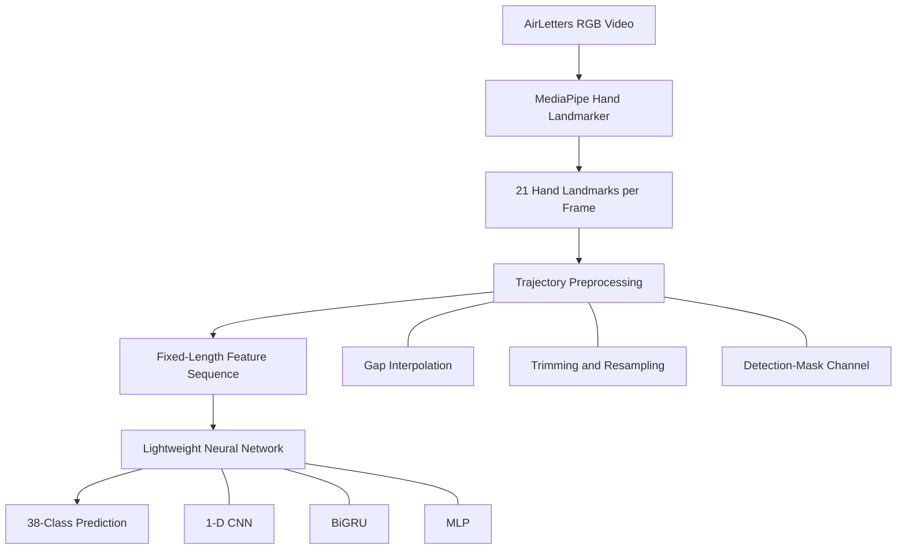
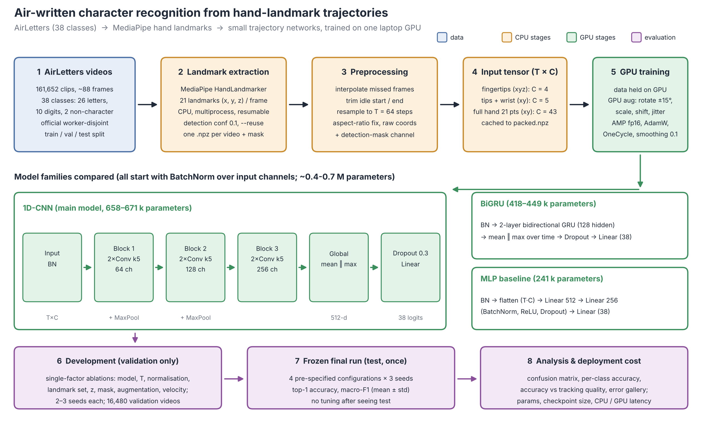
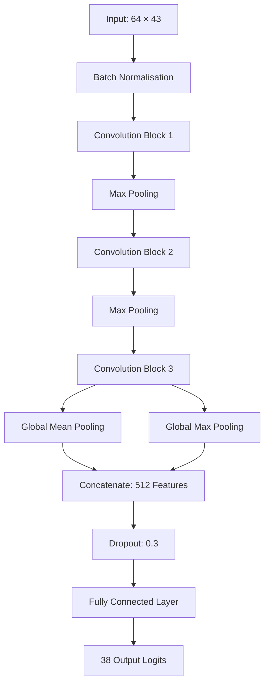

# Recognising Air-Written Characters from Hand-Landmark Trajectories: A Lightweight Baseline on AirLetters

Recognising characters drawn in the air using an ordinary RGB camera, **MediaPipe hand landmarks, and lightweight neural networks** instead of computationally expensive video models.

**Author:** Diya Attri  
Department of Computer Science and Engineering (AI & ML)  
Noida Institute of Engineering and Technology, Greater Noida, India

**Dataset:** [AirLetters — Dagli et al. (2024)](https://arxiv.org/abs/2410.02921)  
**Project status:** Research code accompanying the manuscript *Lightweight Hand-Landmark Trajectory Classification of Characters Drawn in the Air on the AirLetters Dataset*.

---

## Table of Contents

- [Overview](#overview)
- [Key Highlights](#key-highlights)
- [System Architecture](#system-architecture)
- [Model Architecture](#model-architecture)
- [Experimental Results](#experimental-results)
- [Key Findings](#key-findings)
- [Error Analysis](#error-analysis)
- [Repository Structure](#repository-structure)
- [Installation and Setup](#installation-and-setup)
- [Dataset Preparation](#dataset-preparation)
- [Reproducing the Results](#reproducing-the-results)
- [Demos](#demos)
- [Limitations](#limitations)
- [Citation](#citation)
- [Contact](#contact)

---

## Overview

Air-writing recognition is the task of identifying characters drawn in the air using hand movements captured by a camera. While video-based recognition systems can achieve this using computationally expensive deep learning architectures, this project investigates whether lightweight models can achieve competitive performance using hand-landmark trajectories alone.

The pipeline extracts 21 hand landmarks from each video frame using MediaPipe, converts the landmarks into fixed-length temporal sequences, and classifies the resulting trajectories using lightweight neural networks.

Three model families are investigated:

- **1-D Convolutional Neural Network (CNN):** Captures local temporal patterns in landmark trajectories.
- **Bidirectional Gated Recurrent Unit (BiGRU):** Models sequential dependencies in both temporal directions.
- **Multilayer Perceptron (MLP):** Provides a lightweight baseline for trajectory classification.

The experiments evaluate recognition accuracy, macro-F1, model size, inference latency, landmark selection, feature representations, and the relationship between tracking quality and classification errors.

The objective is to study the trade-off between recognition performance and computational efficiency while maintaining a reproducible, validation-driven experimental protocol.

## Key Highlights

- **75.43% ± 0.01 percentage points test accuracy** for the all-joint 1-D CNN, averaged across three random seeds.
- **76.11% test macro-F1** for the same configuration.
- **670,908 parameters** and a reported checkpoint size of approximately 2.6 MB.
- **Approximately 0.90 ms CPU classifier latency** per sample at batch size 1, excluding video decoding and landmark extraction.
- A BiGRU achieves similar accuracy (75.37%) but has a higher reported CPU latency of 16.53 ms.
- Tracking quality strongly correlates with recognition performance: 46.4% accuracy when the hand is detected in fewer than half of the frames, compared with 88.2% when detection succeeds in at least 95% of frames.
- The test split was reserved for evaluation of four frozen configurations, with three seeds per configuration, after development and model selection on the validation split.

**Qualitative demo:** An offline demonstration evaluated 12 randomly selected test videos, using a fixed seed and one video per class. It correctly classified 10 of 12 videos. This small demonstration is illustrative only; it is not the source of the reported benchmark accuracy.

**Comparison caveat:** The AirLetters paper reports 71.20% accuracy for its best video model, ResNeXt-200 3D. Those models were not rerun in this project, and the paper's results table does not specify its evaluation split. Consequently, this comparison is indicative only and does not establish that the proposed method is superior.

---

## System Architecture

The system separates video processing from classification so that the computationally expensive tracking stage can be analysed independently of the lightweight neural network.



### Pipeline Components

**1. Video input**

The system uses the RGB videos provided by the AirLetters dataset. The dataset contains 38 classes, including uppercase letters, digits, and two contrast classes.

**2. Hand-landmark extraction**

MediaPipe Hand Landmarker extracts 21 hand landmarks from each frame. Landmark extraction is performed offline on the CPU and can be parallelised across workers.

**3. Trajectory preprocessing**

The extracted landmarks are transformed into fixed-length sequences through:

- Aspect-ratio correction.
- Interpolation of missing landmark observations.
- Trimming of the trajectory.
- Resampling to 64 temporal steps.
- Addition of a detection-mask channel indicating tracking availability.

**4. Feature representation**

The best-performing model receives an input tensor of shape `64 × 43`, representing 21 landmarks with two coordinates per landmark and one additional detection-mask channel.

**5. Classification**

The processed trajectory is passed to a 1-D CNN, BiGRU, or MLP, depending on the experiment. The classifier outputs logits for the 38 classes.

**6. Prediction and evaluation**

Predictions are evaluated using accuracy and macro-F1. Additional analyses investigate model latency, per-class errors, and the influence of tracking quality.

The shared `features.video_to_feature` function is used for both training-time feature construction and demo inference, reducing the risk of preprocessing inconsistencies.



*Architecture diagram: add the corresponding image at `docs/architecture.png` to display it here.*

---

## Model Architecture

### Best Model: 1-D CNN Using All 21 Hand Joints

The best speed–accuracy configuration uses all 21 hand joints and raw 2-D image coordinates, together with the detection-mask channel.



The CNN consists of three temporal convolution blocks:

| Component | Configuration |
|---|---|
| Input | 64 time steps × 43 features |
| Block 1 | Two Conv1D layers, kernel size 5, 64 channels |
| Block 2 | Two Conv1D layers, kernel size 5, 128 channels |
| Block 3 | Two Conv1D layers, kernel size 5, 256 channels |
| Convolution operations | Batch normalisation and ReLU activation |
| Downsampling | Max pooling by a factor of 2 after the first two blocks |
| Temporal aggregation | Global mean pooling and global max pooling |
| Regularisation | Dropout of 0.3 |
| Output | Fully connected layer producing 38 logits |

Global mean and max pooling combine complementary information about the overall trajectory and its strongest temporal activations. The resulting 512-dimensional representation is passed to the final classification layer.

The architecture is designed to capture useful temporal patterns without requiring a large video backbone or recurrent processing at every inference step.

---

## Experimental Results

The following results are from the reported experiments on the official AirLetters test split, comprising 38 classes and 16,427 videos.

Accuracy and macro-F1 are reported in percentages. Test accuracy for the all-joint CNN and BiGRU is averaged across three seeds; the values after ± represent sample standard deviation in percentage points.

| Model and Input | Validation Accuracy (%) | Test Accuracy (%) | Test Macro-F1 (%) | Parameters | Checkpoint Size (KB) | CPU Latency (ms) |
|---|---:|---:|---:|---:|---:|---:|
| CNN, all 21 joints, 2-D | 78.12 | **75.43 ± 0.01** | 76.11 | 670,908 | 2,645 | **0.90** |
| BiGRU, all 21 joints, 2-D | 77.84 | 75.37 ± 0.04 | 76.11 | 448,892 | 1,760 | 16.53 |
| CNN, fingertips + wrist, 2-D | 76.55 | 73.61 ± 0.23 | 74.73 | 658,672 | 2,597 | 1.91 |
| CNN, fingertips only, 3-D | 74.30 | 71.91 ± 0.10 | 72.96 | 658,350 | 2,596 | 0.92 |

**Interpretation**

The all-joint CNN achieves the highest reported test accuracy among the evaluated configurations while maintaining low classifier latency. The BiGRU achieves comparable recognition performance but takes substantially longer per CPU forward pass in the reported measurements.

The latency measurements were obtained on a laptop at batch size 1 and are hardware-dependent. They exclude video decoding and hand-landmark extraction.

Landmark extraction takes approximately **2.98 seconds of CPU time per video** on the reported machine. Therefore, the full processing pipeline is dominated by tracking rather than neural-network classification.

---

## Key Findings

The following observations are based on the reported validation ablation experiments.

- **Using all 21 joints is beneficial:** The all-joint representation outperforms the fingertip-only representation by approximately 4.5 percentage points in the reported raw-coordinate comparison.
- **Raw coordinates perform well:** Raw image coordinates outperform normalised coordinates by approximately 1.1 percentage points in the fingertip experiment. This finding may depend on the dataset and camera setup.
- **The detection mask matters:** Removing the detection-mask channel reduces accuracy by approximately 1.42 percentage points.
- **Additional motion features did not provide a clear improvement:** Velocity channels and relative-depth features did not show clear benefits in the reported experiments.
- **The CNN provides a favourable speed–accuracy trade-off:** The MLP is approximately 9.5 percentage points less accurate in the reported comparison, while the BiGRU achieves similar accuracy at higher CPU latency.

The complete ablation results are available in the manuscript's Table II and `results/summary.csv`, where present in the repository.

---

## Error Analysis

Error analysis was conducted on the test split using the seed-0 all-joint CNN configuration.

### Tracking Quality and Recognition Errors

Videos in which the hand was detected in fewer than half of the frames represent approximately 23.8% of the test set but account for about 52% of all classification errors.

This indicates that tracking quality is an important factor in the overall performance of landmark-based air-writing recognition.

### Difficult Classes

The most difficult classes in the reported analysis include:

- `0` and `O`
- `B`
- `1`

Frequently observed confusions include:

- `0` ↔ `O`
- `1` ↔ `I`
- `B` ↔ `3`
- Confusions between the two contrast classes

These observations describe patterns in the evaluated predictions. They do not establish the underlying causes of individual errors. In particular, the experiments do not establish whether poor tracking results from fast motion, occlusion, video resolution, or other factors.

---

## Repository Structure

```text
.
├── src/
│   ├── build_manifest.py
│   ├── extract_landmarks.py
│   ├── features.py
│   ├── models.py
│   ├── train.py
│   ├── run_grid.py
│   ├── analyze.py
│   ├── plot_trajectories.py
│   ├── plot_class.py
│   └── check_env.py
│
├── demo/
│   ├── infer.py
│   ├── make_demo_video.py
│   └── webcam_demo.py
│
├── docs/
│   ├── architecture.png
│   └── ...
│
├── models/
│   └── hand_landmarker.task
│
├── results/
│   ├── summary.csv
│   └── ...
│
├── checkpoints/
│   └── ...
│
├── requirements.txt
├── .gitignore
└── README.md
```

### Main Modules

| File | Responsibility |
|---|---|
| `build_manifest.py` | Builds a dataset manifest from the official CSV files |
| `extract_landmarks.py` | Extracts MediaPipe hand landmarks from videos |
| `features.py` | Constructs trajectory features and packs them into model inputs |
| `models.py` | Defines the MLP, 1-D CNN, and BiGRU architectures |
| `train.py` | Trains and evaluates an individual model configuration |
| `run_grid.py` | Runs validation-driven model and feature ablations |
| `analyze.py` | Analyses confusion patterns, per-class accuracy, and tracking quality |
| `plot_trajectories.py` | Generates trajectory visualisations |
| `plot_class.py` | Visualises fingertip paths for a selected class |
| `check_env.py` | Checks Python libraries, GPU availability, and the execution environment |
| `demo/infer.py` | Provides a classifier inference wrapper |
| `demo/make_demo_video.py` | Creates the offline demonstration video |
| `demo/webcam_demo.py` | Runs the live webcam recognition demo |

*The structure above documents the intended repository layout. Include only files that exist in your actual repository, and adjust filenames or paths to match your implementation.*

---

## Installation and Setup

### Requirements

The reported environment uses:

- Python 3
- PyTorch with CUDA support for GPU-enabled training
- MediaPipe
- NumPy
- Pandas
- scikit-learn
- Matplotlib
- OpenCV
- An NVIDIA GPU for the reported GPU-enabled training environment

The project was tested on Windows with an NVIDIA RTX 3060 Laptop GPU with 6 GB VRAM. Other configurations may work but have not necessarily been tested.

### 1. Clone the Repository

```bash
git clone <YOUR_GITHUB_REPOSITORY_URL>
cd <YOUR_REPOSITORY_NAME>
```

Replace the placeholders with the actual GitHub repository URL and directory name.

### 2. Create a Virtual Environment

**Windows PowerShell**

```powershell
python -m venv .venv
.\.venv\Scripts\Activate.ps1
```

**Linux/macOS**

```bash
python3 -m venv .venv
source .venv/bin/activate
```

### 3. Install Dependencies

```bash
python -m pip install --upgrade pip
pip install -r requirements.txt
```

Install a compatible CUDA-enabled PyTorch build using the official [PyTorch installation guide](https://pytorch.org/get-started/locally/) if GPU training is required.

### 4. Download the MediaPipe Model

Download the official MediaPipe Hand Landmarker task model and place it at:

```text
models/hand_landmarker.task
```

Follow the official [MediaPipe Hand Landmarker documentation](https://ai.google.dev/edge/mediapipe/solutions/vision/hand_landmarker).

### 5. Verify the Environment

```bash
python src/check_env.py
```

This script should verify the relevant Python libraries and report whether CUDA and the GPU are available.

---

## Dataset Preparation

The AirLetters videos are **not included in this repository**.

Obtain the dataset from the authors' release associated with [AirLetters (arXiv:2410.02921)](https://arxiv.org/abs/2410.02921) and follow the dataset's licence and access conditions.

The expected dataset structure is:

```text
airletters/
├── videos/
├── train.csv
├── val.csv
└── test.csv
```

The CSV files should correspond to the official train, validation, and test partitions. Keep the official split assignments intact when reproducing the experiments.

The pipeline builds a manifest, extracts hand landmarks, and converts them into packed feature sequences for model training.

---

## Reproducing the Results

The following commands document the reported experimental workflow. Run them from the repository root and verify that the script arguments match the version of the code you are using.

### Step 1: Build the Manifest

```bash
python src/build_manifest.py \
    --root /path/to/airletters \
    --out data/manifest.csv
```

Replace `/path/to/airletters` with the actual dataset directory.

### Step 2: Extract Hand Landmarks

```bash
python src/extract_landmarks.py \
    --manifest data/manifest.csv \
    --video_root /path/to/airletters \
    --out_dir data/lm \
    --model models/hand_landmarker.task \
    --conf 0.1 \
    --reuse
```

The reported run used a confidence threshold of `0.1` and the `--reuse` option, which maintains a landmarker instance across consecutive videos handled by a worker.

The reported mean detection rate was 0.679. Reusing tracker instances may introduce state carryover between videos, which is an experimental limitation discussed below.

### Step 3: Pack Trajectory Features

```bash
python src/features.py pack \
    --manifest data/manifest.csv \
    --lm_dir data/lm \
    --out data/packed.npz
```

The resulting packed feature file is used by the training and evaluation scripts.

### Step 4: Run Development Ablations

Run the development grid using the validation split for model selection:

```bash
python src/run_grid.py \
    --packed data/packed.npz \
    --out results \
    --seeds 3 \
    --epochs 30
```

To run the specific `combo` configuration:

```bash
python src/run_grid.py \
    --packed data/packed.npz \
    --out results \
    --seeds 3 \
    --epochs 30 \
    --only combo
```

### Step 5: Evaluate the Frozen Configurations

The following commands document the reported three-seed evaluation procedure. The test split should be used only after model configurations have been selected using validation results.

**Bash**

```bash
mkdir -p results_final

for s in 0 1 2; do
    python src/train.py --packed data/packed.npz --out results_final --name final_hand --model cnn1d --joints hand --norm raw --seed "$s" --epochs 30 --bs 512 --eval_test

    python src/train.py --packed data/packed.npz --out results_final --name final_hand_gru --model bigru --joints hand --norm raw --seed "$s" --epochs 30 --bs 512 --eval_test

    python src/train.py --packed data/packed.npz --out results_final --name final_tipwrist --model cnn1d --joints tip_wrist --norm raw --seed "$s" --epochs 30 --bs 512 --eval_test

    python src/train.py --packed data/packed.npz --out results_final --name final_tip --model cnn1d --joints tip --norm raw --dims 3 --seed "$s" --epochs 30 --bs 512 --eval_test
done
```

**Windows PowerShell**

```powershell
New-Item -ItemType Directory -Force results_final

for ($s = 0; $s -lt 3; $s++) {
    python src/train.py --packed data/packed.npz --out results_final --name final_hand --model cnn1d --joints hand --norm raw --seed $s --epochs 30 --bs 512 --eval_test

    python src/train.py --packed data/packed.npz --out results_final --name final_hand_gru --model bigru --joints hand --norm raw --seed $s --epochs 30 --bs 512 --eval_test

    python src/train.py --packed data/packed.npz --out results_final --name final_tipwrist --model cnn1d --joints tip_wrist --norm raw --seed $s --epochs 30 --bs 512 --eval_test

    python src/train.py --packed data/packed.npz --out results_final --name final_tip --model cnn1d --joints tip --norm raw --dims 3 --seed $s --epochs 30 --bs 512 --eval_test
}
```

### Reported Training Configuration

- Optimiser: AdamW
- Learning rate: `2e-3`
- Weight decay: `0.01`
- Learning-rate schedule: One-cycle
- Label smoothing: `0.1`
- Batch size: `512`
- Epochs: `30`
- Mixed-precision training
- On-the-fly geometric augmentation
- Checkpoint selection based on validation performance

Exact numerical results may vary with hardware, software versions, and random seeds.

**Important:** Do not use the test set to repeatedly select models, tune hyperparameters, or choose feature configurations. The test set is intended for final evaluation of the frozen configurations.

### Step 6: Perform Error Analysis

```bash
python src/analyze.py \
    --preds results_final/final_hand_s0_preds.npz \
    --packed data/packed.npz \
    --split test \
    --out analysis_hand
```

This analysis examines classification errors and their relationship to tracking quality.

---

## Demos

The project includes an offline video demonstration and a live webcam interface.

### Offline Demonstration

Generate a demonstration using 12 randomly selected test videos with a fixed seed:

```bash
python demo/make_demo_video.py \
    --packed data/packed.npz \
    --manifest data/manifest.csv \
    --video_root /path/to/airletters \
    --ckpt checkpoints/final_hand_s0.pt \
    --split test \
    --n 12 \
    --seed 0
```

The demonstration includes incorrect predictions rather than selectively showing only successful examples.

The reported demonstration classified 10 of 12 videos correctly. This is a qualitative example, not an estimate of generalisation performance.

### Live Webcam Demonstration

```bash
python demo/webcam_demo.py \
    --ckpt checkpoints/final_hand_s0.pt \
    --model_task models/hand_landmarker.task
```

The documented controls are:

| Key | Action |
|---|---|
| `SPACE` | Start or stop drawing |
| `c` | Clear the current trajectory |
| `r` | Record |
| `q` | Quit |

The live demo is sensitive to hand-tracking quality and individual drawing styles. The model recognises the 38 classes defined by the dataset: uppercase letters, digits, and the two contrast classes. It does not support lowercase characters as separate classes.

No live-demo accuracy is reported.

---

## Limitations

Several limitations should be considered when interpreting the results.

1. **Dataset generalisation:** The experiments use one dataset and one hand-tracking system. Performance may differ with other cameras, users, backgrounds, and recording conditions.
2. **Tracking dependence:** Classification accuracy depends heavily on successful landmark detection. Missing or inaccurate landmarks can degrade the trajectory representation.
3. **End-to-end latency:** The reported approximately 0.90 ms CNN latency measures only the classifier's forward pass. Landmark extraction takes approximately 2.98 seconds of CPU time per video on the reported machine.
4. **Potential tracker-state carryover:** The `--reuse` extraction configuration may allow tracker state to carry over between consecutive videos processed by the same worker.
5. **Baseline comparability:** Published video-model results were not independently reproduced. Differences in evaluation protocols may affect direct comparisons.
6. **Validation selection effects:** Although the test split was reserved for four frozen configurations, these configurations were selected after multiple validation experiments. Validation performance may therefore be optimistic.
7. **Limited qualitative demonstration:** The 12-video offline demo illustrates the workflow but is too small to establish reliable performance on unseen examples.
8. **Hardware-dependent timing:** CPU latency measurements are sensitive to system load, processor architecture, and software versions.

These limitations motivate further investigation into robust tracking, independent evaluation, and more efficient end-to-end recognition.

---

## Citation

If you use this repository or build upon the experiments, please cite the original AirLetters dataset paper and, when available, the accompanying research manuscript.

### AirLetters Dataset

```bibtex
@article{dagli2024airletters,
  title   = {AirLetters: An Open Video Dataset of Characters Drawn in the Air},
  author  = {Dagli, Rishit and Berger, Guillaume and Materzynska, Joanna and Bax, Ingo and Memisevic, Roland},
  journal = {arXiv preprint arXiv:2410.02921},
  year    = {2024}
}
```

### Accompanying Manuscript

*Lightweight Hand-Landmark Trajectory Classification of Characters Drawn in the Air on the AirLetters Dataset.*

Add the final manuscript citation here once its publication details or permanent identifier are available.

---

## Contact

**Diya Attri**  
Department of Computer Science and Engineering (AI & ML)  
Noida Institute of Engineering and Technology, Greater Noida, India

Email: diy028a@gmail.com

---

*This repository investigates lightweight, landmark-based air-writing recognition with an emphasis on reproducible evaluation, computational efficiency, and transparent reporting of limitations.*
