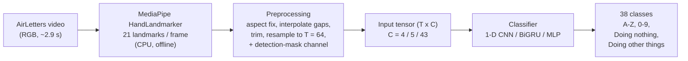
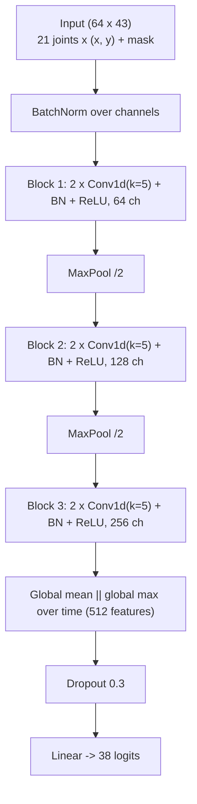

# Recognizing Air-Written Characters from Hand-Landmark Trajectories: A Lightweight Baseline on AirLetters

Recognising characters drawn in the air from an ordinary RGB camera, using **MediaPipe hand landmarks** and **small neural networks** (1-D CNN, BiGRU, MLP) instead of heavy video models.

> **Author:** Diya Attri · Dept. of CSE (AI & ML), Noida Institute of Engineering and Technology, Greater Noida, India
> **Dataset:** [AirLetters](https://arxiv.org/abs/2410.02921) (Dagli et al., 2024) · **Status:** research code accompanying the manuscript *"Lightweight Hand-Landmark Trajectory Classification of Characters Drawn in the Air on the AirLetters Dataset"*

---

## Highlights

- **75.43 ± 0.01 % test accuracy** (76.11 % macro-F1) on the official, worker-disjoint AirLetters test split, 38 classes, mean over 3 seeds.
- **0.67 M parameters**, 2.6 MB checkpoint, **about 0.9 ms** classifier latency on a CPU (batch size 1, forward pass only).
- A BiGRU is equally accurate (75.37 %) but about 18× slower on a CPU (16.5 ms).
- Accuracy depends strongly on tracking quality: **46.4 %** when the hand is found in fewer than half of the frames vs **88.2 %** when found in at least 95 %.
- Honest protocol: all development on the **validation** split; the **test** split was evaluated **once** for four frozen configurations.

> **Caveat on comparisons.** The AirLetters paper reports 71.20 % for its best video model (ResNeXt-200 3D). We did not re-run those models and the paper's table does not state its split, so any comparison is **indicative only**. This repository makes no claim of superiority.

## Pipeline



The same function (`features.video_to_feature`) builds features for training and for the live demo, so there is no preprocessing mismatch.


### Best model: 1-D CNN on all 21 joints



## Results

Test split, official AirLetters split (38 classes, 16,427 videos). Mean ± sample std over 3 seeds. Latency is the classifier forward pass only (batch size 1), excluding video decoding and landmark extraction.

| Model (input) | Val acc. | Test acc. | Test macro-F1 | Params | Size (KB) | CPU (ms) |
|---|---:|---:|---:|---:|---:|---:|
| CNN, all 21 joints, 2-D | 78.12 | **75.43 ± 0.01** | 76.11 | 670,908 | 2,645 | 0.90 |
| BiGRU, all 21 joints, 2-D | 77.84 | 75.37 ± 0.04 | 76.11 | 448,892 | 1,760 | 16.53 |
| CNN, fingertip + wrist, 2-D | 76.55 | 73.61 ± 0.23 | 74.73 | 658,672 | 2,597 | 1.91 |
| CNN, fingertip only, 3-D | 74.30 | 71.91 ± 0.10 | 72.96 | 658,350 | 2,596 | 0.92 |

CPU timings come from a laptop and are noisy (the fingertip+wrist model has almost the same architecture as the others yet measured 1.91 ms). Landmark extraction is far more expensive than classification: about **2.98 s of CPU time per video** on average on our machine, so end-to-end cost is dominated by the tracker.

### Key findings (validation ablations)

- **All 21 joints beat the fingertip alone** (+4.5 points with raw coordinates).
- **Raw image coordinates beat normalised ones** (+1.1 points for the fingertip). This may be dataset-specific.
- Velocity channels and relative depth gave no clear benefit; the detection-mask channel helps (removing it costs 1.42 points).
- The CNN is a better speed/accuracy trade-off than the MLP (−9.5 points) or the BiGRU (similar accuracy, slower on a CPU).

Full ablation table: see the paper (Table II) and the `summary.csv` files in `results/` and `results_dev/`.

### Error analysis (test, seed 0, all-joint CNN)

- Videos with a hand detected in fewer than half of the frames are **23.8 %** of the test set but contain about **52 %** of all errors.
- Hardest classes: "0", "O", "B", "1". Most frequent confusions: "0" ↔ "O", "1" ↔ "I", "B" ↔ "3", and the two contrast classes with each other.
- These are observations, not proven causes; we did not test whether low detection comes from fast motion, occlusion or resolution.

## Repository structure

```
.
├── src/
│   ├── build_manifest.py      # dataset manifest from the official CSVs
│   ├── extract_landmarks.py   # MediaPipe landmark extraction (CPU, multiprocessing)
│   ├── features.py            # trajectory features + packing (shared with the demo)
│   ├── models.py              # MLP, CNN1D, BiGRU
│   ├── train.py               # training / evaluation of one configuration
│   ├── run_grid.py            # development ablation grid (validation only)
│   ├── analyze.py             # confusions, per-class and accuracy-by-tracking-quality
│   ├── plot_trajectories.py   # trajectory figure
│   ├── plot_class.py          # fingertip paths for one class
│   └── check_env.py           # GPU / library check
├── demo/
│   ├── infer.py               # classifier wrapper
│   ├── make_demo_video.py     # offline demo on the test split (fixed seed, no cherry-picking)
│   └── webcam_demo.py         # live webcam demo
├── docs/                      # architecture diagram and the offline demo video
│   ├── architecture.png
│   └── demo_video.mp4
├── figures/                   # figures used in the paper
├── results/                   # development runs: summary CSV and per-run JSON
├── results_dev/               # development runs: summary CSV and per-run JSON
├── results_final/             # frozen final runs (3 seeds): summary, JSON and ckpt/*.pt
├── requirements.txt
└── README.md
```

## Setup

Tested on Windows with Python 3 and an NVIDIA RTX 3060 Laptop GPU (6 GB). Other setups should work but have not been tested by us.

```bash
python -m venv .venv
# Windows: .venv\Scripts\activate      Linux/macOS: source .venv/bin/activate
pip install -r requirements.txt
python src/check_env.py
```

Install a CUDA build of PyTorch from <https://pytorch.org> if `check_env.py` reports that the GPU is not available. Download the MediaPipe **Hand Landmarker** model (`hand_landmarker.task`, float16) from the official MediaPipe documentation into `models/`.

## Data

The AirLetters videos are **not** included. Obtain them from the authors' release (arXiv:2410.02921) and follow their licence. The folder should contain `videos/`, `train.csv`, `val.csv` and `test.csv`.

## Reproducing the results

**1. Manifest, landmarks and packed features**

```bash
python src/build_manifest.py --root /path/to/airletters --out data/manifest.csv
python src/extract_landmarks.py --manifest data/manifest.csv --video_root /path/to/airletters \
       --out_dir data/lm --model models/hand_landmarker.task --conf 0.1 --reuse
python src/features.py pack --manifest data/manifest.csv --lm_dir data/lm --out data/packed.npz
```

Our run used `--conf 0.1` and `--reuse` (one landmarker per worker, so tracker state may carry over between consecutive videos; mean detection rate 0.679).

**2. Development ablations (validation only)**

```bash
python src/run_grid.py --packed data/packed.npz --out results --seeds 3 --epochs 30
python src/run_grid.py --packed data/packed.npz --out results --seeds 3 --epochs 30 --only combo
```

**3. Final test evaluation (four frozen configurations, 3 seeds each)**

```bash
for s in 0 1 2; do
  python src/train.py --packed data/packed.npz --out results_final --name final_hand      --model cnn1d --joints hand      --norm raw          --seed $s --epochs 30 --bs 512 --eval_test
  python src/train.py --packed data/packed.npz --out results_final --name final_hand_gru  --model bigru --joints hand      --norm raw          --seed $s --epochs 30 --bs 512 --eval_test
  python src/train.py --packed data/packed.npz --out results_final --name final_tipwrist  --model cnn1d --joints tip_wrist --norm raw          --seed $s --epochs 30 --bs 512 --eval_test
  python src/train.py --packed data/packed.npz --out results_final --name final_tip       --model cnn1d --joints tip       --norm raw --dims 3 --seed $s --epochs 30 --bs 512 --eval_test
done
```

(PowerShell: `for ($s=0; $s -lt 3; $s++) { ... }`.) Training settings: AdamW (lr 2e-3, weight decay 0.01), one-cycle schedule, label smoothing 0.1, batch size 512, mixed precision, on-the-fly geometric augmentation, best-validation checkpoint.

**4. Error analysis**

```bash
python src/analyze.py --preds results_final/final_hand_s0_preds.npz --packed data/packed.npz --split test --out analysis_hand
```

Numbers can differ slightly across hardware and library versions. The test split must be used only for the final frozen configurations.

## Demos

**Offline demo video:** [docs/demo_video.mp4](docs/demo_video.mp4)

12 random test videos (seed 0, one per class): **10/12 correct**. The two errors are shown too ("O" predicted as "0"; "I" predicted as "Doing Other Things" on a video where the hand was detected in only 28 % of frames). Illustrative only; the reported test accuracy is **75.43 %**.

```bash
# offline demo on random test videos (fixed seed; wrong predictions are shown too)
python demo/make_demo_video.py --packed data/packed.npz --manifest data/manifest.csv \
       --video_root /path/to/airletters --ckpt results_final/ckpt/final_hand_s0.pt \
       --split test --n 12 --seed 0 --overall_acc 75.43 --out docs/demo_video.mp4

# live webcam demo (SPACE start/stop, c clear, r record, q quit)
python demo/webcam_demo.py --ckpt results_final/ckpt/final_hand_s0.pt --model_task models/hand_landmarker.task
```

`--video_root` must be the dataset folder that **contains** `videos/`.

The demos are qualitative and are not part of the reported results. The model recognises **uppercase letters and digits only** (AirLetters has no lowercase classes). Live recognition is sensitive to drawing style: a character drawn differently from the dataset's style (for example "G") can be misread. We do not report live accuracy.

## Limitations

- One dataset and one tracker; results may not transfer to other cameras, framings or users.
- The pipeline inherits the tracker's failures; poor detection is the largest error source.
- Landmark extraction (about 2.98 s CPU per video here) dominates end-to-end cost; the sub-millisecond figure is the classifier only.
- Tracker state may have carried over between videos (`--reuse`).
- Published video baselines were not re-run.
- The test split was used once, but the four configurations were chosen after many validation runs, so validation numbers are somewhat optimistic.

## Citation

If you use this code, please cite the AirLetters paper and, once available, the accompanying manuscript.

```bibtex
@article{dagli2024airletters,
  title   = {AirLetters: An Open Video Dataset of Characters Drawn in the Air},
  author  = {Dagli, Rishit and Berger, Guillaume and Materzynska, Joanna and Bax, Ingo and Memisevic, Roland},
  journal = {arXiv preprint arXiv:2410.02921},
  year    = {2024}
}
```

## Contact

Diya Attri · diy028a@gmail.com